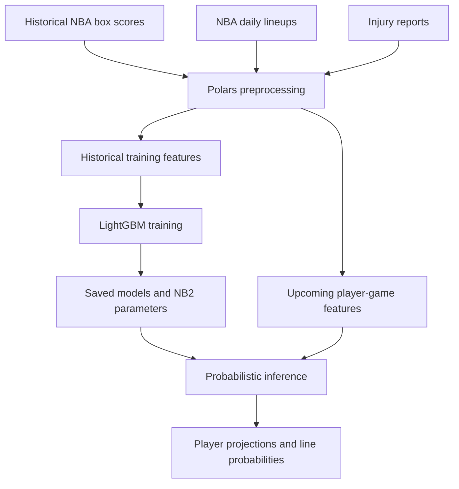

# NBA Models

A Python-based research pipeline for forecasting NBA player points, rebounds and assists using machine learning, historical performance and probabilistic count models.

The project combines historical box scores with upcoming lineup and injury information to produce player-level projections and probability estimates. Its focus is on reproducible feature engineering, time-aware evaluation and uncertainty quantification rather than point predictions alone.

## Architecture



## Model coverage

| Target | Key feature families |
| --- | --- |
| Points | Recent scoring, shot volume, usage, minutes, pace and opponent defensive context |
| Rebounds | Recent total, offensive and defensive rebounds, minutes and rebounding opportunity |
| Assists | Recent assists, assist percentage, minutes and offensive role |

Separate models allow each statistic to have its own feature set and dispersion estimates.

## Data sources

- [Historical NBA Data and Player Box Scores](https://www.kaggle.com/datasets/eoinamoore/historical-nba-data-and-player-box-scores) — historical player-game statistics, including `PlayerStatisticsExtended.csv`.
- [NBA Stats](https://stats.nba.com/) — daily lineup and roster information.
- [NBA injury reports](https://official.nba.com/) — supplementary availability information, accessed through `nbainjuries` in the injury-aware preprocessing workflow.

Historical data can be loaded from a local CSV or through KaggleHub. Upcoming player-game rows are constructed without populating future box-score outcomes.

## Feature engineering

The shared preprocessing pipeline uses Polars lazy frames and produces separate datasets for each target. Feature families include:

- Previous-game statistics, five- and ten-game rolling averages, and exponentially weighted moving averages (EWMA).
- Minutes, usage, shot attempts and recent performance trends.
- Player starting status and availability.
- Opponent defensive history and expected rotation context.
- Experimental rebound percentage features: total, offensive and defensive rebound percentage, each represented by EWMA and ten-game averages.

Historical form features are shifted by one game within each player to exclude the current game's outcome. The lineup-aware workflow identifies starters from starting positions rather than the generic lineup confirmation label. Unknown starting status should remain missing when a starting five cannot be established.

Historical availability derived from box-score comments is only a proxy, not a verified pregame injury snapshot. This distinction is important when evaluating historical performance.

## Statistical methodology

### Conditional mean

LightGBM estimates the expected count for each target given the player's historical and contextual features:

$$\mu_i = f_{\theta}(x_i)$$

Gradient-boosted trees capture nonlinear relationships and interactions between recent performance, playing opportunity and game context.

### Predictive distribution

A negative binomial (NB2) distribution represents count uncertainty around the estimated mean:

$$Y_i \mid x_i \sim \operatorname{NB2}(\mu_i, \alpha_i)$$

$$\operatorname{Var}(Y_i \mid x_i) = \mu_i + \alpha_i\mu_i^2$$

The dispersion parameter allows variance to exceed the mean. The research workflow includes global and bucket-level dispersion estimation, with player-specific hierarchical dispersion explored as an extension. These approaches require out-of-time calibration checks; more complex dispersion is not automatically better.

## Getting started

The following commands reflect the project scripts available during development. Confirm the corresponding filenames and dependency versions in your checkout before running them.

```bash
git clone https://github.com/psar0006/NBA_Models.git
cd NBA_Models
python -m venv .venv
```

Activate the environment on Windows with `.venv\Scripts\activate`, or on macOS/Linux with `source .venv/bin/activate`.

Install the project's requirements where supplied. The main Python stack includes NumPy, Polars, PyArrow, KaggleHub, pandas, SciPy, scikit-learn, LightGBM and joblib. Injury-aware preprocessing additionally uses `nbainjuries` and RapidFuzz.

### 1. Prepare historical features

```bash
python preprocess_nba_props_fuzzy_injuries.py --kaggle --skip-lineups
```

Alternatively, use a local source:

```bash
python preprocess_nba_props_fuzzy_injuries.py --players data/PlayerStatisticsExtended.csv --skip-lineups
```

### 2. Train models

```bash
python retrain_nba_models.py --data-dir processed_nba_props --output-dir models/nba_props_full
```

### 3. Prepare upcoming games

```bash
python preprocess_nba_props_fuzzy_injuries.py --kaggle --lineup-date YYYY-MM-DD
```

Replace `YYYY-MM-DD` with the NBA calendar date in US Eastern time. Refresh the lineup and injury information before inference.

### 4. Generate projections

```bash
python predict_nba_props.py --data-dir processed_nba_props --models-dir models/nba_props_full --output-dir predictions
```

## Project components

The following is a functional map of the development workflow, not a verified listing of the current GitHub tree.

| Component | Purpose |
| --- | --- |
| Preprocessing scripts | Data ingestion, cleaning, lineup integration and feature engineering |
| Training scripts | Chronological model fitting and dispersion estimation |
| Prediction scripts | Load saved models and generate upcoming player projections |
| Research notebooks | Exploratory analysis, feature experiments and calibration diagnostics |
| Pipeline controller | Coordinate repeatable preprocessing, training and inference jobs |

Typical generated artifacts include:

```text
processed_nba_props/
    nba_<prop>_train.parquet
    nba_<prop>_new.parquet
    nba_<prop>_features.txt
models/nba_props_full/<prop>/
    <prop>_mean_lightgbm.joblib
    model_config.json
predictions/
    nba_all_line_odds.csv
```

Here `<prop>` is `points`, `rebounds` or `assists`. Model configurations define the expected input features and distribution parameters. Newly engineered features must be included in the training configuration and the model retrained before they can influence predictions.

## Evaluation and reliability

Evaluation should preserve chronological ordering and compare against simple historical-form baselines. Relevant measures include MAE, RMSE, mean bias, probability calibration and proper probabilistic scoring rules. Assess performance by player role, predicted count range and season rather than relying only on aggregate errors.

Before inference, verify that:

- Upcoming player-game records are unique and correspond to the intended NBA date.
- Confirmed lineups contain five starters per team and unknown status is not silently converted to bench status.
- Model feature names and ordering match the saved configuration.
- Historical features do not incorporate future outcomes.
- Missing values, stale source data and failed lineup requests are surfaced explicitly.

## Limitations and future work

Player minutes, injuries, trades and changing rotation roles can materially affect forecasts. Historical injury proxies may introduce train–inference differences, and negative binomial assumptions may not capture every player's outcome distribution.

Research priorities include explicit minutes and per-minute production modelling, improved availability snapshots, hierarchical dispersion, stronger calibration diagnostics and automated feature-contract tests.

## Disclaimer

This project is for statistical research and educational purposes. Predictions are uncertain and do not guarantee future outcomes. NBA data and third-party datasets remain subject to their respective providers' terms. No affiliation with the NBA is implied.
